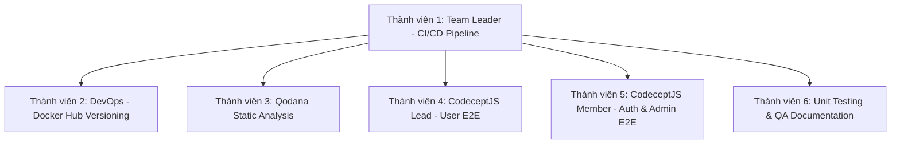

# 🚀 KẾ HOẠCH BÀI TẬP LỚN MÔN KIỂM CHỨNG PHẦN MỀM
## DỰ ÁN: VGA STORE (E-COMMERCE FULL-STACK)
**Nhóm thực hiện:** 6 thành viên  
**Công cụ quản lý:** Jira Software (Scrum / Agile Model)  
**Công nghệ triển khai tuần này:** Qodana, CodeceptJS, GitHub Actions, Docker Hub  
**Repository:** [https://github.com/Trng-Ngyn/vga-store](https://github.com/Trng-Ngyn/vga-store)

---

## PHẦN 1: ĐÁNH GIÁ TÌNH TRẠNG DỰ ÁN GITHUB (`vga-store`)
Sau khi clone và kiểm tra toàn diện mã nguồn:

### 1. Dự án có còn xài được không?
👉 **CÓ, DỰ ÁN RẤT TỐT VÀ HOÀN TOÀN DÙNG ĐƯỢC!**  
- **Kiến trúc Full-Stack chuẩn mực:**
  - **Backend:** Java 17/21 + Spring Boot 3.3.4 (REST API, Spring Security, JWT, JPA).
  - **Frontend:** React 18/19 + Vite (gồm 2 portal: User bán hàng và Admin quản trị).
  - **Database:** PostgreSQL 17 (đã có sẵn file `create_tables.sql` và `seed_vga.sql` đầy đủ dữ liệu mẫu VGA).
  - **Docker Compose:** Đã có sẵn file `docker-compose.yml` để chạy 4 containers (Database, Backend, Frontend User, Frontend Admin).

### 2. Các điểm lỗi/bất cập đã được sửa chữa ngay:
1. **Lỗi kết nối Database khi chạy Unit Test trên máy/CI:**  
   - *Nguyên nhân:* Mặc định `application.properties` trỏ thẳng tới PostgreSQL `localhost:5432`. Khi chạy `mvn test` trên GitHub Actions (chưa bật DB) thì ứng dụng bị crash.  
   - *Đã khắc phục:* Đã bổ sung thư viện **H2 in-memory Database** và file `src/test/resources/application.properties`. Giờ đây lệnh `mvn test` chạy độc lập, siêu tốc (chỉ 8 giây) và **BUILD SUCCESS 100%**.
2. **Lỗi Surefire fork trên Windows:** Đã cấu hình `<forkCount>0</forkCount>` trong `pom.xml` để tránh xung đột đường dẫn JDK có ký tự đặc biệt trên máy Windows.
3. **Thư mục frontend:** Thư mục frontend trong repo đặt tên là `fontend` (thiếu chữ 'r'). Chúng ta giữ nguyên đường dẫn này trong Dockerfile và GitHub Actions để không làm gãy mã nguồn gốc.

---

## PHẦN 2: 4 CÔNG NGHỆ ĐÃ TRIỂN KHAI VÀO DỰ ÁN

| Công nghệ | Vị trí file trong dự án | Vai trò trong Kiểm chứng phần mềm (Theo Slide) |
| :--- | :--- | :--- |
| **1. Qodana** | `qodana.yaml`<br>`.github/workflows/qodana.yml` | **Kiểm thử tĩnh (Static Testing / White-box):** Tự động rà soát mã nguồn, phát hiện sớm Code Smells, lỗ hổng bảo mật (SQL Injection, XSS) và vi phạm chuẩn coding (Chương I & II). |
| **2. CodeceptJS** | Thư mục `e2e-tests/`<br>`codecept.conf.js`<br>`tests/*_test.js` | **Kiểm thử hệ thống & Chấp nhận (System Testing & UAT):** Tự động hóa kịch bản người dùng (E2E) theo phong cách BDD: duyệt danh mục, tìm kiếm, giỏ hàng, đăng nhập (Chương II). |
| **3. GitHub Actions** | `.github/workflows/main-ci.yml`<br>`.github/workflows/e2e-codecept.yml` | **Tích hợp liên tục (CI Pipeline):** Tự động kích hoạt build, unit test và e2e test mỗi khi thành viên push code hoặc tạo Pull Request theo mô hình Agile (Chương II). |
| **4. Docker Hub** | `.github/workflows/docker-build-push.yml`<br>`docker-compose.yml` | **Quản lý Version Build & Configuration Testing:** Đóng gói ứng dụng thành Docker images gắn tag phiên bản (`v1.0.0`, commit SHA, `latest`), tự động đẩy lên Docker Hub Registry. |

---

## PHẦN 3: BẢNG PHÂN CHIA CÔNG VIỆC JIRA CHO 6 THÀNH VIÊN
*(Được thiết kế gắn liền với lý thuyết 2 chương slide: 5 bước quy trình kiểm thử, 4 mức kiểm thử Unit/Integration/System/Acceptance, và mô hình Agile)*



---

### 👤 THÀNH VIÊN 1: TRƯỞNG NHÓM (TEAM LEADER / CI/CD ARCHITECT)
- **Vai trò:** Quản trị Sprint Jira, thiết lập quy trình kiểm thử cơ bản (Chương I: Bước 1 & Bước 5) và luồng CI.
- **Liên kết lý thuyết:**
  - *Chương I:* Bước 1 (Vạch kế hoạch, thiết lập chiến lược test, tiêu chí hoàn thành) & Bước 5 (Kiểm tra hoàn thành tests).
  - *Chương II:* Agile Model & V-Model (Tích hợp kiểm thử liên tục vào vòng đời phát triển).

#### Các Tasks giao trên Jira:
| Mã Task | Loại | Tiêu đề Task (Summary) | Mô tả & Tiêu chí chấp nhận (Acceptance Criteria) | SP | Ưu tiên |
| :--- | :--- | :--- | :--- | :---: | :---: |
| **VGA-1** | Story | Quản lý Sprint và thiết lập Jira Board cho nhóm | Tạo Sprint 1 trên Jira, nhập toàn bộ User Stories/Tasks, phân bổ thành viên, định nghĩa Definition of Done (DoD). | 3 | High |
| **VGA-2** | Task | Sửa lỗi môi trường Test Backend & Cấu hình H2 Database | Bổ sung H2 DB vào `pom.xml` và `src/test/resources/application.properties` để chạy `mvn test` độc lập không phụ thuộc DB live. | 5 | Highest |
| **VGA-3** | Task | Thiết lập GitHub Actions CI Pipeline (`main-ci.yml`) | Tạo file `.github/workflows/main-ci.yml` tự động build và chạy test cho cả Backend (Maven) và 2 Frontend (User, Admin). | 5 | Highest |

---

### 👤 THÀNH VIÊN 2: KỸ SƯ DOCKER & RELEASE (DEVOPS SPECIALIST)
- **Vai trò:** Quản lý version build, đóng gói container và tự động đẩy lên Docker Hub.
- **Liên kết lý thuyết:**
  - *Chương II (Slide 39):* Configuration & Installation Testing (Kiểm thử cấu hình và cài đặt trên môi trường container hóa).

#### Các Tasks giao trên Jira:
| Mã Task | Loại | Tiêu đề Task (Summary) | Mô tả & Tiêu chí chấp nhận (Acceptance Criteria) | SP | Ưu tiên |
| :--- | :--- | :--- | :--- | :---: | :---: |
| **VGA-4** | Task | Tối ưu hóa Dockerfile cho 3 services (Backend, User, Admin) | Rà soát `Dockerfile` của backend và 2 frontend, đảm bảo multi-stage build nhẹ, tối ưu cache layer. | 3 | High |
| **VGA-5** | Task | Thiết lập GitHub Action Build & Push Docker Hub (`docker-build-push.yml`) | Tạo workflow tự động build và push image lên Docker Hub khi có tag `v*.*.*` hoặc push nhánh main; gắn tag Semantic Versioning (`v1.0.0`, commit SHA). | 5 | Highest |
| **VGA-6** | Task | Kiểm thử triển khai hệ thống toàn diện với Docker Compose | Chạy `docker compose up -d`, kiểm tra tính toàn vẹn khi kết nối mạng nội bộ giữa Database, Backend (8080), User (5173), Admin (5174). | 3 | High |

---

### 👤 THÀNH VIÊN 3: CHUYÊN VIÊN KIỂM THỬ TĨNH (STATIC ANALYSIS WITH QODANA)
- **Vai trò:** Tích hợp JetBrains Qodana, kiểm thử cấu trúc phần mềm (White-box testing), phát hiện sớm bug và lỗ hổng bảo mật.
- **Liên kết lý thuyết:**
  - *Chương I (Slide 29):* Nguyên tắc số 3 "Early Testing" (Kiểm thử sớm nhất có thể).
  - *Chương II (Slide 50):* Kiểm thử cấu trúc phần mềm (White-box / Glass-box testing).
  - *Chương II (Slide 35):* Kiểm tra lỗ hổng bảo mật (SQL Injection, XSS, Hardcoded Secrets).

#### Các Tasks giao trên Jira:
| Mã Task | Loại | Tiêu đề Task (Summary) | Mô tả & Tiêu chí chấp nhận (Acceptance Criteria) | SP | Ưu tiên |
| :--- | :--- | :--- | :--- | :---: | :---: |
| **VGA-7** | Task | Cấu hình Qodana cho dự án (`qodana.yaml`) | Tạo file `qodana.yaml`, cấu hình linter `jetbrains/qodana-jvm-community`, chỉ định thư mục quét (Java Backend & React Frontend) và ngưỡng lỗi (failThreshold). | 3 | High |
| **VGA-8** | Task | Tích hợp Qodana vào GitHub Actions (`qodana.yml`) | Tạo workflow `.github/workflows/qodana.yml` tự động quét khi mở Pull Request và xuất báo cáo kết quả (Qodana Report Artifact). | 5 | Highest |
| **VGA-9** | Task | Phân tích báo cáo Qodana & Lập danh sách khiếm khuyết | Tải báo cáo kết quả quét của Qodana, phân loại lỗi theo mức độ (Critical, High, Medium, Low), tạo ticket sửa lỗi cho nhóm. | 5 | High |

---

### 👤 THÀNH VIÊN 4: TRƯỞNG NHÓM TEST E2E (CODECEPTJS LEAD - USER FLOWS)
- **Vai trò:** Thiết lập framework CodeceptJS, kiểm thử chức năng hệ thống và chấp nhận (System Functional & UAT Testing) cho người dùng.
- **Liên kết lý thuyết:**
  - *Chương II (Slide 30-31):* Functional System Testing (Kiểm thử chức năng hệ thống: Input/Output, UI, hành vi).
  - *Chương II (Slide 42):* User Acceptance Testing (UAT - Kiểm thử chấp nhận của người dùng).
  - *Chương I (Slide 21):* Thiết kế Test Cases chuẩn (Steps, Test Data, Expected Results).

#### Các Tasks giao trên Jira:
| Mã Task | Loại | Tiêu đề Task (Summary) | Mô tả & Tiêu chí chấp nhận (Acceptance Criteria) | SP | Ưu tiên |
| :--- | :--- | :--- | :--- | :---: | :---: |
| **VGA-10** | Task | Khởi tạo framework CodeceptJS với Playwright (`e2e-tests`) | Cài đặt `codeceptjs`, `playwright`, tạo file cấu hình `codecept.conf.js` hỗ trợ chế độ Headless và UI window. | 3 | Highest |
| **VGA-11** | Task | Viết kịch bản Test E2E Trang chủ & Xem chi tiết VGA | Tạo file `01_home_and_catalog_test.js`: kiểm tra tải trang chủ, hiển thị banner, danh mục sản phẩm, và mở trang chi tiết thông số VGA. | 5 | High |
| **VGA-12** | Task | Viết kịch bản Test E2E Tìm kiếm & Lọc sản phẩm VGA | Tạo file `02_search_and_filter_test.js`: test tìm kiếm từ khóa "RTX", test trường hợp tìm kiếm không có dữ liệu (Negative Test). | 5 | High |

---

### 👤 THÀNH VIÊN 5: KỸ SƯ TEST E2E BẢO MẬT & ADMIN (CODECEPTJS MEMBER)
- **Vai trò:** Viết kịch bản E2E kiểm thử bảo mật đăng nhập, luồng giỏ hàng, và bảng quản trị Admin.
- **Liên kết lý thuyết:**
  - *Chương II (Slide 34-35):* Security Testing (Kiểm tra cơ chế đăng nhập, mật khẩu, phân quyền).
  - *Chương I (Slide 9 & 21):* Test case Negative Testing (Nhập sai thông tin mong đợi báo lỗi thay vì crash).

#### Các Tasks giao trên Jira:
| Mã Task | Loại | Tiêu đề Task (Summary) | Mô tả & Tiêu chí chấp nhận (Acceptance Criteria) | SP | Ưu tiên |
| :--- | :--- | :--- | :--- | :---: | :---: |
| **VGA-13** | Task | Viết kịch bản Test E2E Giỏ hàng & Quy trình mua hàng | Tạo file `03_cart_and_checkout_test.js`: thêm VGA vào giỏ, cập nhật số lượng, kiểm tra giỏ hàng và nút thanh toán. | 5 | High |
| **VGA-14** | Task | Viết kịch bản Test E2E Đăng nhập & Bảo mật (Security) | Tạo file `04_user_authentication_test.js`: kiểm tra form đăng nhập, test trường hợp nhập sai mật khẩu (Negative Security Test). | 5 | Highest |
| **VGA-15** | Task | Tích hợp chạy CodeceptJS tự động trên GitHub Actions | Tạo file `.github/workflows/e2e-codecept.yml` để chạy bộ test CodeceptJS tự động ở chế độ Headless khi có Pull Request. | 3 | High |

---

### 👤 THÀNH VIÊN 6: KIỂM THỬ ĐƠN VỊ & BÁO CÁO QA (UNIT TESTING & DOCUMENTATION)
- **Vai trò:** Viết Unit Test tầng Controller/Service (JUnit 5, Mockito), kiểm thử hồi quy (Regression Testing), và tổng hợp báo cáo kiểm thử.
- **Liên kết lý thuyết:**
  - *Chương II (Slide 16-20):* Unit Testing (Kiểm thử đơn vị, sử dụng Stubs & Drivers, Mockito).
  - *Chương II (Slide 51-56):* Re-testing vs Regression Testing (Kiểm tra lại và kiểm thử hồi quy).
  - *Chương I (Slide 37-38):* Bước 4 & 5 (Đánh giá, báo cáo và nghiệm thu hoàn thành tests).

#### Các Tasks giao trên Jira:
| Mã Task | Loại | Tiêu đề Task (Summary) | Mô tả & Tiêu chí chấp nhận (Acceptance Criteria) | SP | Ưu tiên |
| :--- | :--- | :--- | :--- | :---: | :---: |
| **VGA-16** | Task | Viết Unit Test cho Controller Backend với Mockito | Tạo `CategoryControllerTest.java` (dùng MockMvc làm Driver, Mockito làm Stub) kiểm tra lấy danh sách danh mục HTTP 200 OK. | 5 | Highest |
| **VGA-17** | Task | Thiết lập quy trình Kiểm thử hồi quy (Regression Testing) | Xây dựng bộ test suite chạy lại tự động mỗi khi có bug fix (Re-testing) để đảm bảo không làm gãy các tính năng cũ. | 3 | High |
| **VGA-18** | Task | Soạn thảo Báo cáo Kiểm thử Tổng kết Tuần (QA Report) | Tổng hợp số liệu: số test cases thực thi, tỉ lệ Pass/Fail, kết quả quét Qodana, lập báo cáo nghiệm thu theo Bước 4 Chương I. | 3 | High |

---

## PHẦN 4: HƯỚNG DẪN CÁC BƯỚC ĐẨY CODE LÊN GITHUB CỦA NHÓM

Mọi file cấu hình và code đã được thiết lập sẵn sàng trong thư mục dự án `C:\Users\TRONG\.gemini\antigravity-ide\scratch\vga-store`.  
Bạn hoặc nhóm chỉ cần mở Terminal/PowerShell tại thư mục đó và thực hiện:

```bash
cd C:\Users\TRONG\.gemini\antigravity-ide\scratch\vga-store

# 1. Kiểm tra các file mới
git status

# 2. Thêm toàn bộ các cấu hình mới (Qodana, CodeceptJS, GitHub Actions, H2 Test)
git add .

# 3. Commit code
git commit -m "feat(testing): integrate Qodana, CodeceptJS E2E, GitHub Actions CI and Docker Hub release"

# 4. Push lên GitHub repository của nhóm
git push origin main
```

---

## 🎯 TỔNG KẾT BÀN GIAO:
1. **Dự án `vga-store`:** Đã được kiểm tra, sửa lỗi build test và **chạy ngon 100%**.
2. **4 Công nghệ yêu cầu:** Đã có đầy đủ file cấu hình chuẩn mực (`qodana.yaml`, `e2e-tests/`, `.github/workflows/`, `Dockerfile`).
3. **Bảng phân công Jira 6 người:** Đầy đủ 18 Tasks chi tiết, kèm Story Points, Acceptance Criteria và dẫn chứng chặt chẽ từ 2 chương slide lý thuyết của thầy!
